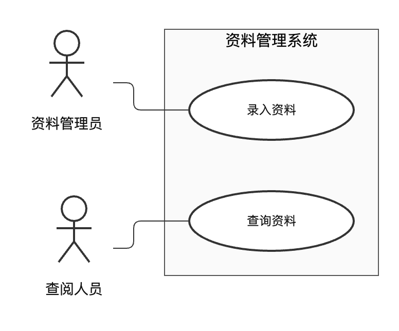
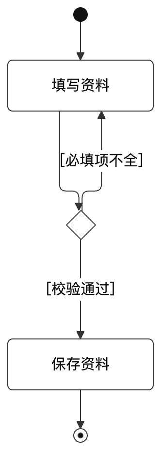

# 资料管理系统 需求规格说明

## 修订记录

| 版本 | 日期 | 修订说明 | 编制 | 审核 |
|---|---|---|---|---|
| V1.0 | 2026-11 | 初稿 | （待填写） | （待填写） |

## 目录

- 1 概述
  - 1.1 系统概述
  - 1.2 用户与角色
- 2 功能需求
  - 2.1 资料录入

## 1 概述

### 1.1 系统概述

本系统用于录入和查询资料，系统上下文如图 1-1 所示。

图 1-1 系统上下文图

图 1-1 中，资料管理员录入资料，查阅人员查询资料。

### 1.2 用户与角色

本系统的用户分为两类，各角色的职责见表 1-1。

表 1-1 角色

| 角色 | 职责 |
|---|---|
| 资料管理员 | 录入资料，维护资料的分类与标签 |
| 查阅人员 | 查询资料 |

各角色的使用特点如下：

- 资料管理员熟悉资料分类规则。
- 查阅人员只使用查询功能。

## 2 功能需求

### 2.1 资料录入

资料录入的流程如图 2-1 所示。

图 2-1 资料录入活动图

图 2-1 中，资料管理员填写资料后提交，必填项齐全时系统保存资料。

#### 2.1.1 录入步骤

资料录入按以下顺序进行：

1. 资料管理员填写资料。
2. 系统校验必填项。
3. 系统保存资料。

##### 约束与异常处理

必填项不全时，系统指出缺少的项目，资料管理员补全后重新提交。
